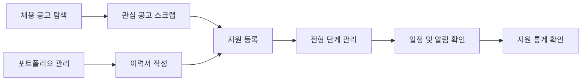

  

  # 💼 취업모아 (Job-Moa)

  **채용 공고부터 지원 결과까지, 취업 준비의 모든 과정을 한곳에서**

  공고 탐색 · 스크랩 · 지원 현황 · 일정 · 이력서를 통합 관리하는 개인화 취업 관리 서비스

---

## 📝 1. 프로젝트 개요

취업모아(Job-Moa)는 여러 플랫폼과 도구에 흩어진 구직 정보를 하나의 흐름으로 연결하는 취업 준비 통합 서비스입니다.

사용자는 다양한 채용 플랫폼의 공고를 한곳에서 탐색하고, 관심 공고를 저장한 뒤 지원 과정을 단계별로 관리할 수 있습니다. 공고 마감일과 면접 일정은 캘린더에 모아보고, 지원 통계와 실시간 알림을 통해 자신의 취업 여정을 놓치지 않고 확인할 수 있습니다. 이력서 작성부터 포트폴리오 관리, PDF 저장까지 지원해 공고 탐색 이후의 준비 과정도 함께 연결합니다.

- **개발 기간**: 3월 10일 ~ 4월 19일
- **참여 인원**: 6명 (Frontend 3명, Backend 3명)
- **핵심 가치**: 공고 탐색부터 지원 결과까지 이어지는 취업 준비 과정의 통합

---

## 🚨 2. 기획 배경 및 해결 방안

### 2.1. 기존 취업 준비 방식의 불편함

1. **채용 정보의 분산**  
   채용 공고가 여러 플랫폼에 흩어져 있어 원하는 정보를 반복해서 검색해야 합니다.

2. **지원 기록과 일정의 파편화**  
   스크랩, 지원 현황, 면접 일정이 서로 다른 앱이나 문서에 기록되어 전체 흐름을 파악하기 어렵습니다.

3. **지원 과정의 가시성 부족**  
   현재 진행 중인 전형과 결과를 한눈에 확인하기 어려워 다음 행동을 계획하기 쉽지 않습니다.

4. **이력서와 포트폴리오의 반복 관리**  
   지원할 때마다 이력서와 관련 파일을 별도로 찾고 수정해야 하는 번거로움이 있습니다.

### 2.2. 취업모아의 해결 방식

- **통합 공고 탐색**: 여러 채용 플랫폼의 공고와 사용자가 직접 등록한 공고를 한곳에 모읍니다.
- **지원 과정 연결**: 관심 공고, 지원 상태와 전형 일정을 하나의 데이터 흐름으로 관리합니다.
- **직관적인 시각화**: 칸반 보드, 캘린더와 통계 차트로 취업 준비 현황을 보여줍니다.
- **문서 통합 관리**: 이력서 작성, 포트폴리오 첨부, 미리보기와 PDF 저장을 지원합니다.
- **실시간 정보 전달**: 지원 결과와 일정 변경을 사용자별 알림으로 빠르게 전달합니다.

---

## ⭐ 3. 핵심 기능

### 3.1. 채용 공고 통합 조회

원티드, 사람인, 인크루트와 점핏의 채용 공고를 한곳에서 조회합니다. 키워드 검색과 출처별 필터를 제공하며, 서비스에 없는 공고도 URL 분석 또는 직접 입력으로 추가할 수 있습니다.

### 3.2. 스크랩 및 지원 관리

관심 공고를 저장하고 실제 지원으로 연결합니다. 지원한 공고는 전형 단계별 칸반 보드에 표시되며, 드래그 앤 드롭으로 현재 상태를 직관적으로 변경할 수 있습니다.

### 3.3. 통합 일정 관리

공고 마감일과 면접 등 전형 일정을 하나의 캘린더에 표시합니다. 월간·주간·일간 보기를 지원해 필요한 범위의 일정을 확인할 수 있습니다.

### 3.4. 취업 통계 대시보드

전체 지원 수, 진행 중인 전형과 합격률을 요약합니다. 단계별 지원 분포와 월별 지원 추이를 시각화해 현재 취업 활동을 한눈에 보여줍니다.

### 3.5. 이력서 및 포트폴리오

구조화된 입력 폼으로 이력서를 작성하고 복제·수정·미리보기할 수 있습니다. 포트폴리오 파일을 함께 관리하고 완성된 이력서를 PDF로 저장할 수 있습니다.

### 3.6. 실시간 알림 및 댓글

지원 결과와 일정 변경을 사용자별 실시간 알림으로 전달합니다. 공고 상세 페이지에서는 댓글을 통해 채용 관련 정보와 의견을 공유할 수 있습니다.

### 3.7. 사용자 인증 및 계정 관리

이메일 회원가입과 Google 로그인을 지원합니다. 프로필 이미지, 비밀번호 재설정, 로그아웃과 회원 탈퇴 등 계정 관리 기능을 제공합니다.

---

## 🔄 4. 서비스 이용 흐름

1. 여러 플랫폼의 채용 공고를 검색하거나 원하는 공고를 직접 등록합니다.
2. 관심 공고를 스크랩하고 마감일을 확인합니다.
3. 이력서와 포트폴리오를 준비한 뒤 지원 정보를 등록합니다.
4. 전형 진행에 따라 지원 상태를 변경하고 관련 일정을 관리합니다.
5. 상태 및 일정 변경 알림을 받고 대시보드에서 전체 지원 과정을 확인합니다.

---

## 🏗️ 5. 서비스 구성

| 구성 | 역할 |
| --- | --- |
| **사용자 서비스** | 공고 탐색, 스크랩, 지원 현황, 캘린더, 통계와 이력서 관리 화면 제공 |
| **통합 API 서버** | 사용자 인증과 공고·지원·일정·이력서 데이터를 연결하고 비즈니스 로직 처리 |
| **채용 공고 수집 서버** | 외부 채용 플랫폼의 공고를 자동·수동으로 수집하고 중복 없이 저장 |
| **데이터베이스 및 파일 저장소** | 사용자별 구직 데이터와 이력서·포트폴리오 파일을 안전하게 관리 |
| **실시간 알림 시스템** | 지원 결과와 일정 변경 사항을 사용자별 채널로 전달 |

---

## 👥 6. 팀원

| 이름 | 역할 | 담당 |
| --- | --- | --- |
| **이규현** | Frontend | 사용자 인증, 캘린더, 통계 분석, 공고 스크랩 |
| **이승훈** | Frontend | 채용 공고, 지원 현황, 일정 등록 |
| **이주창** | Frontend | 이력서 작성 폼, 이력서 관리 |
| **박도은** | Backend / Team Lead | 크롤링 서버, 공고 크롤링 API, 이력서 관리 API |
| **박상선** | Backend | 서버 인프라, 사용자 API, 알림·댓글 |
| **이청미** | Backend | 공고 API, 지원·메모 API, 캘린더 API |

---

  <strong>취업모아는 흩어진 기회를 연결하는 도구이자, 더 나은 설계를 위해 끊임없이 고민한 기록입니다.</strong>

